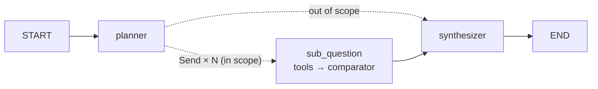

# 💊 Pharma Research Agent

Agentic research assistant that answers compound pharmacology questions over a local corpus of FDA
labels (DailyMed) and MedlinePlus monographs: **decomposition, agent-driven tool choice (3 local tools), hybrid
RAG with reranking, a comparator (critic) and a cited synthesis**, orchestrated with **LangGraph**.

> Syntax GenAI Bootcamp — coding assignment · Mohamed BENHAYOUN SADAFI (EMSI) · 2026
> ⚠️ Technical exercise — **not medical advice**.

The architecture reuses the multi-source RAG assistant I designed during a previous internship
(semantic chunking, sub-question routing with confidence scores, hybrid search 75/25 + reranking,
comparator agent, synthesizer agent), adapted to this corpus and to the assignment's constraints.

## Quick start

```bash
cp .env.example .env          # OPENAI_API_KEY, OPENAI_BASE_URL, OPENAI_MODEL, OPENAI_EMBEDDING_MODEL
docker build -t agent . && docker run -p 8000:8000 --env-file .env agent
# or, equivalently: docker compose up -d --build   (stop: docker compose down)
```

UI: <http://localhost:8000> · API:

```bash
curl localhost:8000/health
curl -X POST localhost:8000/ask -H "Content-Type: application/json" -d '{"question": "What are the main contraindications for warfarin?"}'
```

Without Docker: `uv sync && uv run uvicorn pharma_agent.api:app`

## Code (3 Python files)

| File | Role |
|---|---|
| [`pharma_agent/ingest.py`](pharma_agent/ingest.py) | Semantic chunking section by section, LLM titles, embeddings → `index/` |
| [`pharma_agent/agent.py`](pharma_agent/agent.py) | In-memory hybrid index, 3 tools, LangGraph orchestration (planner, sub-question branches, synthesizer) |
| [`pharma_agent/api.py`](pharma_agent/api.py) | FastAPI: `GET /health`, `POST /ask`, UI |
| [`pharma_agent/static/index.html`](pharma_agent/static/index.html) | Single-page UI with "See details" |

## 1. Ingestion — semantic chunking (`python -m pharma_agent.ingest`)

Each `##` section of each document is chunked independently, so a chunk never mixes two sections:

1. Split into sentences with **spaCy** (sentencizer).
2. **Embed every sentence** (`text-embedding-3-small`).
3. Walk the sentences: a sentence joins the previous chunk if its **cosine similarity** with the previous
   sentence is above a threshold, otherwise it starts a new chunk.
4. The threshold is **calibrated per section by binary search** so that chunks average **500 characters**.
5. Chunks **> 600** chars are cut into ⌈size/500⌉ pieces with **10 % overlap**.
6. Chunks **< 300** chars are merged with the previous chunk, else the next one, if the result stays ≤ 600
   (repeated until no merge is possible).
7. The LLM writes a **title/context (≤ 10 words)** for every chunk; title + chunk are embedded.

The result (`index/chunks.json`, `index/embeddings.npy`) is versioned, so the container starts instantly.
If the embedding model differs from the one used at ingestion, chunks are re-embedded at startup.

## 2. Question answering (`POST /ask`)

Orchestrated as a **LangGraph `StateGraph`**: the planner node fans out with `Send` to one parallel
`sub_question` branch per sub-question; the branches' results are merged into the state (`operator.add` reducer)
before the synthesizer node.



LLM calls go straight through the OpenAI SDK (LiteLLM proxy): LangGraph only handles the orchestration
(state, parallel fan-out, merge), which keeps every prompt and tool explicit.

```
question
  └─ PLANNER: decompose into sub-questions; for each one, choose the tools and their arguments (JSON)
  └─ for each sub-question (in parallel)
       └─ TOOL 1 search_corpus(source)  — always called, on every source with confidence ≥ 0.5
            sources (catalog summary): dailymed (FDA labels) · medlineplus (consumer info)
            hybrid search: 0.75 × semantic (cosine) + 0.25 × keyword (BM25), min-max normalised
            50 candidates → LLM reranker (0–10) → top 5 → agent answer citing [file]
       └─ TOOL 2 read_label_section(drug, section)  — only when a precise drug AND section are targeted
            exact lookup, no similarity: returns the whole `##` section of the FDA label, word for word
       └─ TOOL 3 glossary_lookup(terms)  — only when a term must be defined
            exact definitions from GLOSSARY.md
       └─ COMPARATOR (critic): does each answer address the sub-question? is every claim supported by the
            chunks / exact excerpts? flags unsupported / clinically ambiguous claims and contradictions,
            keeps both answers if consistent, the most reliable one if they contradict → verified answer
  └─ SYNTHESIZER: final answer from verified sub-answers, [file] citations, "Points to verify", disclaimer
```

Tool choice is made by the LLM (planner), not hard-coded: it only sees each tool's description, the list of
drugs and the list of label sections (both read from the corpus).

The response contains `answer`, `sources` (file › section › title), `details` (sub-questions, tools called with
their arguments, each search agent's 50 retrieved chunks with reranker scores — the 5 kept are flagged —, exact
sections and definitions, comparator verdict) and `disclaimer`.

### Adaptations vs. my internship design
- **Weaviate → numpy in memory**: the assignment requires in-memory similarity and a single container.
- **Cross-encoder / Voyage reranker → LLM reranker**: only OpenAI models are available through the provided key,
  and a local cross-encoder would add PyTorch (~2 GB) to the image.
- **No Excel/SQL agent**: the corpus contains no tables, so the relational agent has nothing to query; the two
  search sources become DailyMed and MedlinePlus, and two exact-lookup tools (label section, glossary) are added.
- The provided `.env` names the proxy URL `OPENAI_BASE_UR` and quotes its values: both spellings are accepted
  and quotes are stripped (`docker --env-file` keeps them).

## Evaluation

```bash
uv run python -m tests.eval_questions --verbose
```

Runs the 4 public questions and checks that the expected source files are cited.

## AI assistance

Built with Claude Code. The AI configuration is versioned in [`.claude/`](.claude/) and [`CLAUDE.md`](CLAUDE.md).
